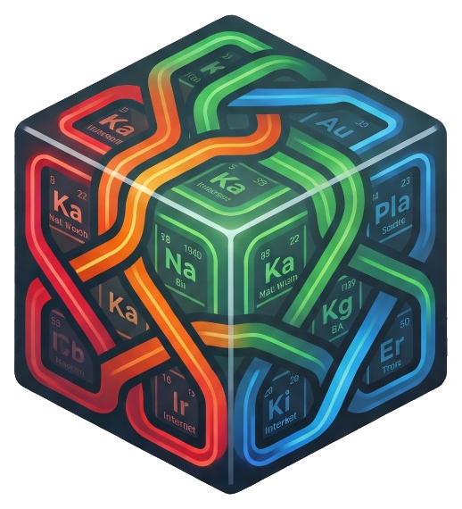

# Udini Periodic Table — 3D Data Visualization

<p align="center">
  
</p>

An interactive 3D web visualization application built with **Three.js (`CSS3DRenderer`)**, **Tween.js**, **PapaParse**, and **Google Identity Services (OAuth 2.0)**. Inspired by the classic Three.js CSS3D Periodic Table demo, this project dynamically fetches live profile records from a Google Sheet and renders them in 3D space across four interactive spatial formations.

🔗 **Live Demo:** [https://periodictableassignment.vercel.app](https://periodictableassignment.vercel.app)

---

## ✨ Key Features

- **Google OAuth 2.0 Authentication**: Secure client-side sign-in powered by Google Identity Services (`accounts.google.com/gsi/client`).
- **Live Google Sheets Integration**: Fetches and parses real-time CSV data directly from Google Sheets using **PapaParse**.
- **Custom 3D Profile Tiles**: Each 3D card displays the person's **Country** (top-left), **Age** (top-right), **Profile Photo** (center, decoded asynchronously), **Full Name**, and **Interest**.
- **Net Worth Color Coding**:
  - 🟥 **Red** (`rgba(239, 48, 34, 0.8)`): Net Worth **< $100,000**
  - 🟧 **Orange** (`rgba(245, 166, 35, 0.8)`): Net Worth **$100,000 – $200,000**
  - 🟩 **Green** (`rgba(58, 148, 72, 0.8)`): Net Worth **> $200,000**
- **Five 3D Spatial Layouts**:
  1. **TABLE (`20 × 10`)**: Organizes 200 profile tiles into a 20-column by 10-row periodic table grid.
  2. **SPHERE**: Distributes tiles evenly across a 3D Fibonacci sphere.
  3. **HELIX (Double Helix)**: Interleaves tiles along two opposing intertwined helical strands ($180^\circ$ phase offset).
  4. **GRID (`5 × 4 × 10`)**: Arranges tiles into a 3D volumetric matrix of 5 columns, 4 rows, and 10 depth layers.
  5. **PYRAMID (4-Face Tetrahedron)**: Arranges tiles across the 4 equilateral triangular faces of a regular 3D tetrahedron.
- **Interactive 3D Camera Controls**: Rotate, pan, and zoom smoothly in 3D space using `TrackballControls`.

---

## 🛠️ Tech Stack

- **Bundler / Dev Environment**: [Vite](https://vitejs.dev/)
- **3D Rendering**: [Three.js](https://threejs.org/) (`CSS3DRenderer`, `CSS3DObject`, `TrackballControls`)
- **Animations**: [@tweenjs/tween.js](https://github.com/tweenjs/tween.js/)
- **CSV Parsing**: [PapaParse](https://www.papaparse.com/)
- **Authentication**: Google Identity Services (OAuth 2.0)
- **Deployment**: [Vercel](https://vercel.com/)

---

## 📂 Project Structure

```text
periodictable_assignment/
├── public/
│   ├── logo.png              # Application cube logo & favicon
│   └── privacy.html          # Privacy Policy page for Google OAuth verification
├── src/
│   ├── main.js               # Three.js CSS3D scene, CSV fetching, and layout transforms
│   └── style.css             # Styling for landing page, login card, and 3D CSS tiles
├── index.html                # Entry HTML (Public landing view, Google login, and 3D canvas)
├── vite.config.js            # Vite server configuration (COOP headers for OAuth popup)
├── vercel.json               # Vercel routing and response header configuration
└── package.json              # Project dependencies and npm scripts
```

---

## 🚀 Getting Started Locally

### 1. Clone the repository
```bash
git clone https://github.com/udini16/periodictable_assignment.git
cd periodictable_assignment
```

### 2. Install dependencies
```bash
npm install
```

### 3. Run the development server
```bash
npm run dev
```
Open [http://localhost:5173](http://localhost:5173) in your browser.

### 4. Build for production
```bash
npm run build
```

